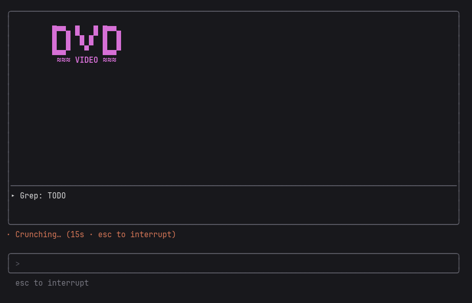

# DVD Screensaver for Claude Code



A Claude Code plugin for the terminal that brings back the classic bouncing DVD-logo screensaver.
When a turn has been running for more than 15 seconds, the spinner line
grows into a box that fills the terminal above the prompt (the "working…"
line stays underneath it). The logo drifts diagonally inside it, bounces off the edges,
and changes color on every bounce. When it lands exactly in a corner, you get
a pop-up. Corner hits are rare on a big terminal, so one start in four is a
lucky one that hits a corner within a minute; the rest are left to chance. The box goes away as soon as the turn ends or you interrupt it.

## Install

At the prompt of a Claude Code terminal session:

```
/plugin install dvd-screensaver --marketplace sky0matic/claude-dvd-screensaver
```

Answer `y` to add the marketplace, then pick a scope. From a shell instead:

```
claude plugin install dvd-screensaver --marketplace sky0matic/claude-dvd-screensaver
```

The screensaver draws in the Claude Code terminal only. In the desktop app,
VS Code or on mobile the plugin does nothing.

## What you see

While the screensaver is up, the bottom of the box lists the last three tool
calls, so you can still follow what Claude is doing.

## Tune it

Edit the constants at the top of `hooks/register.tsx` in a copy of the plugin: `DELAY_MS` sets how long
a turn runs before the screensaver starts, `FRAME_MS` sets the animation speed,
`CORNER_CHANCE` sets how often a start is a lucky one, `FIRST_CORNER_MS` sets
how soon a lucky start hits its corner,
`RESERVED_ROWS` sets how many rows are left free for the prompt, and
`FEED_ROWS` sets how many tool calls the feed lists.

## License

MIT. See [LICENSE](LICENSE).
